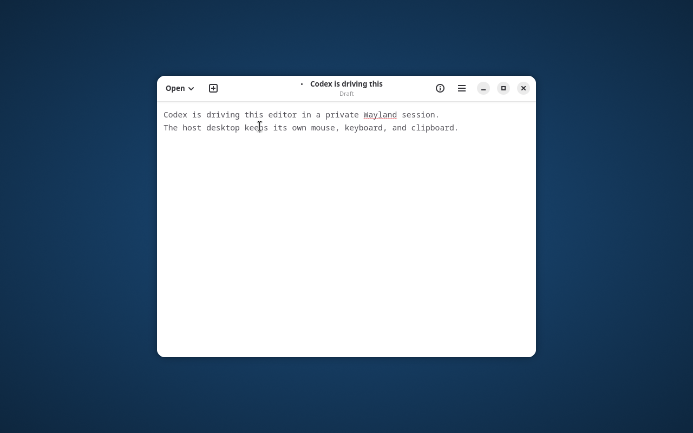

# GNOME Wayland MCP

Test native Linux GUI apps from an MCP client in a private headless GNOME Wayland desktop. The server starts Mutter with one virtual monitor and launches a configured Wayland app so an agent can capture screenshots, click through an interface, and enter text while you keep using your regular desktop. The server uses MCP over stdio, and the quick start below uses Codex.



*Actual `screenshot` response from the registered MCP running through Codex. Codex launched GNOME Text Editor, clicked its editing area, and entered the text shown.*

## Quick start

Both installation methods require Codex and Linux with Mutter, D-Bus, PipeWire, WirePlumber 0.5 or later, and GStreamer installed under `/usr/bin`. The example uses GNOME Text Editor. On Fedora, install any missing runtime dependencies with the following command.

```sh
sudo dnf install mutter dbus-daemon pipewire wireplumber gstreamer1 \
  pipewire-gstreamer gstreamer1-plugins-base gstreamer1-plugins-good gnome-text-editor
```

### Download the Linux x86_64 binary

The [v0.2.0 release](https://github.com/nobadwordss/gnome-wayland-mcp/releases/tag/v0.2.0) provides a statically linked Linux x86_64 executable. You can install and run it without a Rust toolchain.

```sh
archive=gnome-wayland-mcp-v0.2.0-linux-x86_64.tar.gz
release=https://github.com/nobadwordss/gnome-wayland-mcp/releases/download/v0.2.0
curl -fLO "$release/$archive" &&
  curl -fLO "$release/$archive.sha256" &&
  sha256sum -c "$archive.sha256" &&
  tar -xzf "$archive" &&
  install -Dm755 "${archive%.tar.gz}/gnome-wayland-mcp" "$HOME/.local/bin/gnome-wayland-mcp"
```

Register the installed executable with Codex.

```sh
codex mcp add gnome-wayland-mcp -- "$HOME/.local/bin/gnome-wayland-mcp" \
  -- /usr/bin/gnome-text-editor --standalone
codex mcp get gnome-wayland-mcp
```

### Build from source

Use Rust 1.91 or later to build and register the server from a checkout.

```sh
git clone https://github.com/nobadwordss/gnome-wayland-mcp.git
cd gnome-wayland-mcp
cargo build --locked --release
codex mcp add gnome-wayland-mcp -- "$PWD/target/release/gnome-wayland-mcp" \
  -- /usr/bin/gnome-text-editor --standalone
codex mcp get gnome-wayland-mcp
```

### Try it in Codex

Open a new Codex session and try the following prompt.

> Use `gnome-wayland-mcp` to start the private desktop and launch the configured app. Take a screenshot, click the editing area, and enter “Hello from the private desktop.” Take another screenshot to verify the text, then stop the desktop.

To choose a different app, change the executable and arguments after the second `--`. Pass an absolute path to a native Wayland executable. The default resolution is 1280 × 800. To change it, pass `--width` and `--height` before the second `--`.

## Codex skill

Install the [`$gnome-wayland-mcp` skill](skills/gnome-wayland-mcp/SKILL.md) for guidance on running an app in the private desktop, capturing its screen, and verifying mouse and keyboard input. Set up the MCP server using the quick start above, then install the skill in your Codex user directory.

```sh
skill_file="$(mktemp)" &&
curl -fsSL https://raw.githubusercontent.com/nobadwordss/gnome-wayland-mcp/main/skills/gnome-wayland-mcp/SKILL.md \
  -o "$skill_file" && \
  install -Dm644 "$skill_file" "${CODEX_HOME:-$HOME/.codex}/skills/gnome-wayland-mcp/SKILL.md" &&
  rm -f "$skill_file"
```

Open a new Codex session and mention `$gnome-wayland-mcp` in your prompt.

### Firefox example

With native Wayland Firefox installed at `/usr/bin/firefox`, add a separate MCP entry for it. If you built the server from source, use the absolute path to `target/release/gnome-wayland-mcp` instead of the installed binary path.

```sh
codex mcp add gnome-wayland-firefox -- "$HOME/.local/bin/gnome-wayland-mcp" \
  -- /usr/bin/firefox --no-remote --new-instance about:blank
```

The server gives Firefox a temporary home, and the Firefox flags start a separate instance. Open a new Codex session and try the following prompt.

> Use `$gnome-wayland-mcp` with the `gnome-wayland-firefox` MCP entry. Start the private desktop and launch Firefox. Capture the window and click the address bar. Enter `https://example.com/`, then capture the window to verify the address. Press Enter, capture the loaded page, and stop the private desktop.

## Verified environment

| Component | Tested version |
| --- | --- |
| OS | Fedora Workstation 45, x86_64 |
| GNOME Shell and Mutter | 51.1 |
| PipeWire | 1.6.11 |
| WirePlumber | 0.5.19 |
| GStreamer | 1.28.9 |
| Rust | 1.100.0 |
| Codex CLI | 0.171.0-alpha.13 |
| GNOME Text Editor | 51.0 |

The Codex test verified screenshots, coordinate clicks, shortcut keys, and Unicode input. The text editor saved the expected UTF-8 text, including a line break and an emoji. The included GTK smoke test also checks mouse movement, scrolling, stale frame rejection, and session cleanup. It needs Python with PyGObject, GTK 4, and Pillow:

```sh
python3 -B tests/headless_smoke.py target/release/gnome-wayland-mcp
```

The clipboard integration tests run against a disposable D-Bus daemon and pass real Unix file descriptors. They exercise late transfer signals, missing transfers, and stalled clipboard writes. Run them with the Rust toolchain and `/usr/bin/dbus-daemon` installed.

```sh
cargo test --locked mutter::tests
```

Compatibility beyond the environment above remains unverified. The server uses Mutter's private D-Bus interfaces, which can change between versions.

## MCP tools

| Tool | What it does |
| --- | --- |
| `desktop_start` | Starts a private Mutter desktop with one virtual monitor. |
| `desktop_status` | Reports desktop and application status. |
| `launch_app` | Starts the app specified in the server's arguments. |
| `screenshot` | Returns a PNG and its `frame_id`, `width`, and `height`. |
| `mouse_move` | Moves the pointer to `{frame_id, x, y}`. |
| `mouse_click` | Clicks `{point: {frame_id, x, y}, button}`. Defaults to `left`. |
| `mouse_scroll` | Scrolls at `{point: {frame_id, x, y}, vertical, horizontal}`. Positive steps move down or right. |
| `press_key` | Sends `{key, modifiers}`. Supports lowercase ASCII letters, digits, and named keys such as `Enter` and `Left`. |
| `type_text` | Pastes up to 16 KiB of UTF-8 from `{text}` into the focused editable field. Defaults to Ctrl+V. |
| `desktop_stop` | Stops the desktop and the running app. |

Screenshot coordinates start at the top-left pixel. Each pointer action uses the current `frame_id`. A new screenshot, app launch, or input invalidates earlier IDs. A `dispatched` response confirms delivery to Mutter. For `type_text`, Mutter also acknowledges a clipboard transfer and can request the text for its own clipboard cache. Use a fresh screenshot to verify that the app inserted the text before pressing Enter or replacing the clipboard with another `type_text` call.

Pass `{"text":"Hello","paste_shortcut":"ctrl_shift_v"}` for apps whose paste shortcut is Ctrl+Shift+V. Omit `paste_shortcut`, pass `null`, or pass `"ctrl_v"` to use Ctrl+V.

## Session behavior

The private desktop owns its Wayland socket, D-Bus, PipeWire, keyboard focus, and clipboard. Screenshots and input apply to apps launched inside that desktop. The app gets a temporary home and profile, which are removed when the session ends. Save any files you want to retain to an explicit persistent path. After a successful `type_text` call, the text remains available to apps on the private clipboard until another paste replaces it or the session stops. Mutter can also retain a cached copy after a paste error. Check the app before retrying an error that reports possible dispatch.

The runtime uses the installed Mutter executable directly. Docker, GNOME Shell extensions, Xwayland, RDP, and host screen-sharing permission are optional to the host and unnecessary for this server. Apps run with the invoking user's OS permissions and can access files and the network as that user. Choose an app you trust.

The server stops the private session on `desktop_stop`, stdio closure, `SIGINT`, or `SIGTERM`. If the server is killed with `SIGKILL`, or an app moves into a separate process group, some processes may remain.

## License

[MIT](LICENSE)
