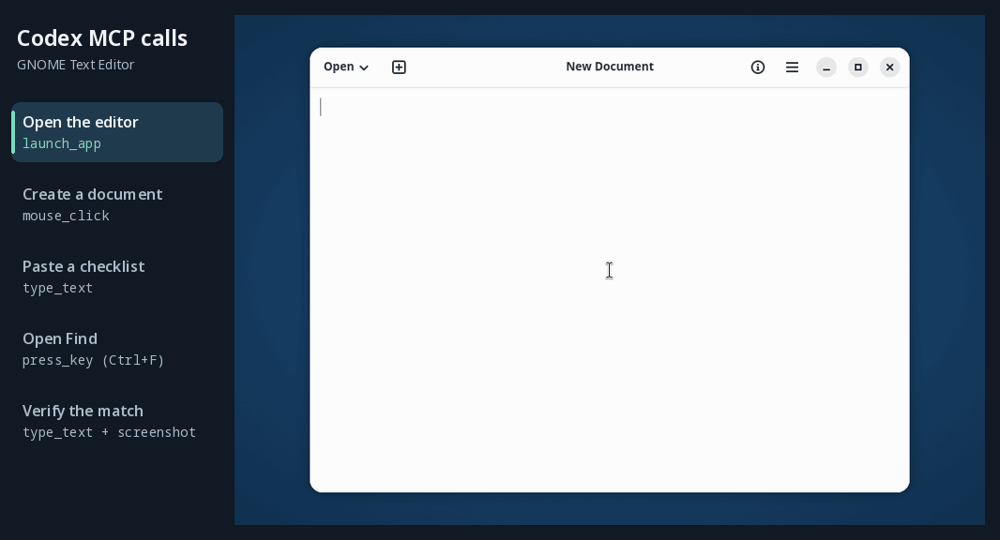

# GNOME Wayland MCP

Test native Linux GUI apps with an MCP agent on a separate GNOME Wayland display. The agent can launch a configured app, capture screenshots, click, and type while you keep using your regular desktop.

[Linux runtime requirements](#requirements). End-to-end testing covers Codex on Fedora Workstation 45 (x86_64) with Mutter 51.1. The release binary also passes the GTK smoke test on Ubuntu 26.04 LTS (x86_64) with Mutter 50.1. Claude Code and Gemini CLI have standard local stdio setup examples.

[Install for Codex](#install-for-codex) · [Download for Linux x86_64](#download-the-linux-x86_64-binary) · [Claude Code](#claude-code) · [Gemini CLI](#gemini-cli)



*Actual v0.2.2 screenshots from the private display, shown alongside the MCP calls that produced them.* [Full-size screenshot from the original Codex test](docs/codex-headless-demo.png).

## Quick start

### Requirements

Use a Linux host with Mutter, D-Bus, PipeWire, WirePlumber 0.5 or later, and GStreamer installed under `/usr/bin`. The examples use GNOME Text Editor. On Fedora, install any missing runtime dependencies with the following command.

```sh
sudo dnf install mutter dbus-daemon pipewire pipewire-utils wireplumber gstreamer1 \
  pipewire-gstreamer gstreamer1-plugins-base gstreamer1-plugins-good gnome-text-editor
```

On Ubuntu 26.04 LTS, install the distribution packages below. Mutter and GNOME Text Editor are available in Ubuntu's Universe repository.

```sh
sudo apt update
sudo apt install curl mutter dbus-daemon pipewire pipewire-bin wireplumber libgl1-mesa-dri \
  gstreamer1.0-tools gstreamer1.0-pipewire gstreamer1.0-plugins-base \
  gstreamer1.0-plugins-good gnome-text-editor
```

Ubuntu 24.04 LTS ships WirePlumber 0.4, below the required version.

### Install for Codex

With the Codex CLI on your `PATH`, run this on Linux x86_64 as your regular user.

```sh
curl -fsSLo install-codex.sh https://raw.githubusercontent.com/nobadwordss/gnome-wayland-mcp/main/scripts/install-codex.sh &&
  bash install-codex.sh
```

From a checkout, run `bash scripts/install-codex.sh`. The installer checks for the desktop runtime and GNOME Text Editor, downloads and verifies the `v0.2.6` archive, and installs the executable under `~/.local/share/gnome-wayland-mcp/v0.2.6/`. It registers `gnome-wayland-mcp` for GNOME Text Editor and prints the result of `codex mcp get`. If an entry with that name is already configured, the installer reports it and exits. Use [manual registration](#codex) if you want to choose a different executable or app.

Open a **new Codex chat** and follow the [first-run example](#try-it). The skill is optional.

### Download the Linux x86_64 binary

The [v0.2.6 release](https://github.com/nobadwordss/gnome-wayland-mcp/releases/tag/v0.2.6) provides a statically linked Linux x86_64 executable. You can install and run it without a Rust toolchain.

```sh
archive=gnome-wayland-mcp-v0.2.6-linux-x86_64.tar.gz
release=https://github.com/nobadwordss/gnome-wayland-mcp/releases/download/v0.2.6
curl -fLO "$release/$archive" &&
  curl -fLO "$release/$archive.sha256" &&
  sha256sum -c "$archive.sha256" &&
  tar -xzf "$archive" &&
  install -Dm755 "${archive%.tar.gz}/gnome-wayland-mcp" "$HOME/.local/bin/gnome-wayland-mcp"
```

### Build from source

Use Rust 1.91 or later to build the server from a checkout.

```sh
git clone https://github.com/nobadwordss/gnome-wayland-mcp.git
cd gnome-wayland-mcp
cargo build --locked --release
```

## Connect your MCP client

Use a client that launches local stdio servers and passes image tool results to the model. The examples assume the downloaded binary is in `~/.local/bin`. If you built from source, use the absolute path to `target/release/gnome-wayland-mcp`.

### Codex

Use manual registration with a downloaded or locally built binary. If you used the installer, go directly to [Try it](#try-it).

```sh
codex mcp add gnome-wayland-mcp -- "$HOME/.local/bin/gnome-wayland-mcp" \
  -- /usr/bin/gnome-text-editor --standalone
codex mcp get gnome-wayland-mcp
```

### Claude Code

```sh
claude mcp add --transport stdio --scope user gnome-wayland-mcp \
  -- "$HOME/.local/bin/gnome-wayland-mcp" -- /usr/bin/gnome-text-editor --standalone
claude mcp get gnome-wayland-mcp
```

See the [Claude Code stdio setup guide](https://code.claude.com/docs/en/mcp#option-3-add-a-local-stdio-server).

### Gemini CLI

Add this entry under `mcpServers` in your user `~/.gemini/settings.json` and replace `/home/you` with your own absolute path.

```json
{
  "mcpServers": {
    "gnome-wayland-mcp": {
      "command": "/home/you/.local/bin/gnome-wayland-mcp",
      "args": ["--", "/usr/bin/gnome-text-editor", "--standalone"]
    }
  }
}
```

Run `gemini mcp list` to check the connection. See the [Gemini CLI MCP configuration guide](https://geminicli.com/docs/tools/mcp-server/).

## Try it

Open a new session in your MCP client. With the GNOME Text Editor registration above, try this prompt without installing the skill.

> Open GNOME Text Editor on a separate desktop without moving my mouse or taking keyboard focus from my desktop. Wait until you can see the editor, then open a new document and enter “Hello from the private desktop” and “한글 입력 확인” on separate lines. Take a fresh screenshot and verify both lines. Close the private desktop without saving and confirm that it has stopped.

If the tools are unavailable in the new chat, run `codex mcp get gnome-wayland-mcp` to check the registration and executable path. Codex may ask for approval before clicking, pasting, sending keys, or stopping the private desktop. Review the tool and its target before approving. If the server can open or capture the app but input is blocked, check the session's approval policy. A non-interactive `codex exec` session with `-a never` rejects tool calls that require approval. [Codex approval settings](https://learn.chatgpt.com/docs/config-file/config-reference)

To launch a different app, replace the executable and arguments after the server's `--` separator. Use an absolute path to a native Wayland executable. The default resolution is 1280 × 800. Pass `--width` and `--height` before the server's `--` to change it.

## Optional Codex skill

After [installing for Codex](#install-for-codex) or [registering manually](#codex), you can add the [`$gnome-wayland-mcp` skill](skills/gnome-wayland-mcp/SKILL.md) for reusable guidance on running apps in the private desktop and verifying mouse and keyboard input.

```sh
skill_file="$(mktemp)" &&
curl -fsSL https://raw.githubusercontent.com/nobadwordss/gnome-wayland-mcp/main/skills/gnome-wayland-mcp/SKILL.md \
  -o "$skill_file" && \
  install -Dm644 "$skill_file" "${CODEX_HOME:-$HOME/.codex}/skills/gnome-wayland-mcp/SKILL.md" &&
  rm -f "$skill_file"
```

Open a new Codex session and describe the app task in your own words. Codex can select the skill when the request matches its description. You can also mention `$gnome-wayland-mcp` to select it explicitly. [Codex skill invocation](https://learn.chatgpt.com/docs/build-skills#how-chatgpt-and-codex-use-skills)

> 내 화면과 마우스에 영향을 주지 않고 GNOME 텍스트 편집기를 열어 새 문서에 “봄바람 체크”와 “한글 입력 확인”을 한 줄씩 넣어줘. 앱 화면에서 두 줄을 확인한 뒤 저장 없이 테스트용 데스크톱을 종료하고 종료됐는지 확인해줘.

### Firefox example

With native Wayland Firefox installed at `/usr/bin/firefox`, add a separate MCP entry for it. If you built the server from source, use the absolute path to `target/release/gnome-wayland-mcp` instead of the installed binary path.

```sh
codex mcp add gnome-wayland-firefox -- "$HOME/.local/bin/gnome-wayland-mcp" \
  -- /usr/bin/firefox --no-remote --new-instance about:blank
```

The server gives Firefox a temporary home, and the Firefox flags start a separate instance. Open a new Codex session and try the following prompt.

> Use `$gnome-wayland-mcp` with the `gnome-wayland-firefox` MCP entry. Start the private desktop and launch Firefox. Capture the window and click the address bar. Enter `https://example.com/`, then capture the window to verify the address. Press Enter, capture the loaded page, and stop the private desktop.

### Ptyxis example

Use this example with GNOME's Ptyxis terminal installed at `/usr/bin/ptyxis`, Bash at `/usr/bin/bash`, and `gnome-wayland-mcp` v0.2.2 or later registered in Codex. Launch Codex with an argument override for this invocation. The temporary `PATH` lets Ptyxis start Bash directly inside the private session by omitting the optional `systemd-run` launcher.

```sh
(
  set -eu
  test_path=$(mktemp -d /tmp/gnome-wayland-ptyxis.XXXXXXXX)
  trap 'rm -f -- "$test_path/bash"; rmdir -- "$test_path"' EXIT
  ln -s /usr/bin/bash "$test_path/bash"

  ptyxis_args=$(printf '%s' \
    '["--", "/usr/bin/env", "PATH='"$test_path"'", "LC_ALL=C.UTF-8", ' \
    '"PS1=paste-test $ ", "/usr/bin/ptyxis", "--standalone", ' \
    '"--", "/usr/bin/bash", "--noprofile", "--norc", "-i"]')
  codex -c "mcp_servers.gnome-wayland-mcp.args=$ptyxis_args"
)
```

In that Codex session, use `$gnome-wayland-mcp` and follow these steps.

1. Call `desktop_start`, then `launch_app`. Capture the terminal and click its pane once the shell prompt appears.
2. Call `type_text` with `{"text":"한글 붙여넣기 확인 🌱🙂","paste_shortcut":"ctrl_shift_v"}`. Send one line with no trailing newline. Leave the text at the prompt without pressing Enter.
3. Take a fresh screenshot and verify the Korean text and emoji on the same prompt line. If they have yet to appear, capture again before retrying.
4. Call `desktop_stop` and confirm that `desktop_status` reports `stopped`. Exit the test Codex invocation to remove the temporary `PATH` directory.

## Verified environment

| Component | Tested version |
| --- | --- |
| OS | Fedora Workstation 45, x86_64 |
| GNOME Shell and Mutter | 51.1 |
| PipeWire | 1.6.11 |
| WirePlumber | 0.5.19 |
| GStreamer | 1.28.9 |
| Rust | 1.100.0 |
| Codex CLI | 0.171.0-alpha.13 |
| GNOME Text Editor | 51.0 |
| Ptyxis | 50.1 |

The Codex test verified screenshots, coordinate clicks, shortcut keys, and Unicode input. The text editor saved the expected UTF-8 text, including a line break and an emoji.

The GTK smoke test passes on Ubuntu 26.04 LTS (x86_64) with Mutter 50.1, PipeWire 1.6.2, WirePlumber 0.5.13, and GStreamer 1.28.2. It covers capture, mouse and keyboard input, repeated Unicode paste, stale frame rejection, and session cleanup. To run it on your host, install Python with PyGObject, GTK 4, and Pillow. On Ubuntu, install `python3-gi gir1.2-gtk-4.0 python3-pil` and use `/usr/bin/python3`.

```sh
python3 -B tests/headless_smoke.py target/release/gnome-wayland-mcp
```

The clipboard integration tests run against a disposable D-Bus daemon and pass real Unix file descriptors. They exercise late transfer signals, missing transfers, and stalled clipboard writes. Run them with the Rust toolchain and `/usr/bin/dbus-daemon` installed.

```sh
cargo test --locked mutter::tests
```

The server uses Mutter's private D-Bus interfaces, which can change between versions. The table records the versions used for end-to-end testing.

### Codex automatic selection smoke test

With the runtime and GTK smoke test dependencies installed, sign in to Codex CLI and run the following from this checkout. On Fedora, the fixture uses Noto Sans CJK KR from `google-noto-sans-cjk-vf-fonts` to display Korean syllables. You can also pass the verified v0.2.5 release executable as the first argument.

```sh
python3 -B tests/codex_routing_smoke.py target/release/gnome-wayland-mcp \
  --model gpt-6.2-sol --reasoning-effort high
```

The script starts two fresh Codex sessions and supplies only this local MCP server. The GTK fixture keeps its window hidden through the first screenshot after launch. The GUI request passes when Codex captures the visible window before input, pastes the exact two Korean lines, takes a new screenshot, reports the code shown after input, and stops the desktop with a `stopped` status. The file-only request must return the second line of `sample.txt` with zero MCP calls. The printed artifact directory contains the prompts, JSONL events, and PNG evidence.

The script stages the bundled skill in each temporary workspace by default. Add `--without-skill` to test tool selection with that skill disabled. It applies per-tool approval overrides for click, paste, key, and stop on the disposable server for each test invocation. Model, CLI version, and available tools can affect selection.

On Fedora Workstation 45 with Mutter 51.1, v0.2.5 passed both requests in one run with the skill enabled and three runs with it disabled. These runs used Codex CLI 0.171.0-alpha.13 and `gpt-6.2-sol` with high reasoning effort.

### wbox comparison on Fedora

This benchmark uses GNOME Wayland MCP v0.2.5 and wbox-mcp 0.15.0 on the same Fedora Workstation 45 x86_64 host with Mutter 51.1, GTK 4.24.1, and GStreamer 1.28.9. Both use headless Mutter, a 960×540 output, and the same GTK4 text field. The two wbox settings differ only in `timeouts.app_render`, which defaults to 3 seconds. [GNOME Wayland MCP v0.2.5](https://github.com/nobadwordss/gnome-wayland-mcp/releases/tag/v0.2.5) · [wbox 0.15.0](https://github.com/quazardous/wbox-mcp/tree/0de008ed922ebf9dc05c213fb047d6952d015474) · [wbox startup wait](https://github.com/quazardous/wbox-mcp/blob/0de008ed922ebf9dc05c213fb047d6952d015474/src/wbox/compositor/mutter.py#L246-L268)

The runner starts a fresh MCP process and desktop each time. It runs each condition 12 times, using all six orders twice. Every condition uses the same GTK readiness check and first-PNG color marker. The runner then checks the exact Korean text in the GTK buffer, pauses the session's GStreamer capture process for 6 seconds, and expects an error during the pause. After resuming it checks for the new PNG marker and the same app PID and text. The run ends when the app, capture, desktop, and server have exited and the private runtime has been removed. GNOME Wayland MCP uses `type_text`. Both wbox settings use `clipboard_write` followed by `hold` for Ctrl+V. [Benchmark runner](benchmarks/wbox_mutter.py)

| Metric | GNOME Wayland MCP v0.2.5 | wbox default (3 s) | wbox `app_render: 0` |
| --- | ---: | ---: | ---: |
| Failed trials | 0/12 | 0/12 | 0/12 |
| First complete success | 8.29 s | 11.28 s | 8.92 s |
| Complete run, median (min–max) | 8.23 s (8.16–8.29) | 11.22 s (11.10–11.32) | 8.92 s (8.84–9.14) |
| MCP start to app launch reply, median | 1.20 s | 4.03 s | 0.95 s |
| Launch reply to first verified app frame, median | 0.59 s | 0.23 s | 0.99 s |
| MCP start to verified Korean paste, median | 1.81 s | 4.79 s | 2.46 s |
| Capture error during the pause, median | 0.2 ms | 5.40 s | 5.40 s |
| Resume to verified new PNG, median | 0.30 s | 0.26 s | 0.26 s |

Complete times run from MCP process start to cleanup and include the 6-second pause. First complete success counts only elapsed trials for that condition through its first pass. All three passed on their first trial. Medians and ranges use successful trials. The expected error during the pause counts toward a pass.

Setting the wbox wait to zero reduced the median complete run by 2.30 seconds. The median wait from the launch reply to the first verified app frame rose from 0.23 to 0.99 seconds. With the fixed wait disabled, the median complete run was 0.69 seconds longer than GNOME Wayland MCP in this benchmark. These measurements cover one GTK workload with an explicit readiness check on the wbox Mutter backend.

For reproduction, install the [runtime dependencies](#requirements) and the Fedora packages `python3-gobject`, `python3-pillow`, `gtk4`, `pipewire-pulseaudio`, and `wl-clipboard`. Download and verify the v0.2.5 release archive using its accompanying SHA-256 file. With `uv` installed, run these commands from this repository.

```sh
bench_deps=$(mktemp -d)
git clone https://github.com/quazardous/wbox-mcp.git "$bench_deps/wbox-mcp"
git -C "$bench_deps/wbox-mcp" checkout --detach 0de008ed922ebf9dc05c213fb047d6952d015474
uv sync --project "$bench_deps/wbox-mcp" --frozen --python 3.14.10
uv pip install --python "$bench_deps/wbox-mcp/.venv/bin/python" 'jeepney==0.9.0'
/usr/bin/python3 -B benchmarks/wbox_mutter.py \
  /path/to/v0.2.5/gnome-wayland-mcp "$bench_deps/wbox-mcp/.venv/bin/wbox-mcp" \
  --output "$bench_deps/results"
```

The runner writes `trials.jsonl`, server logs, and before/after PNGs to the new output directory. It records the stage and reason for each failed trial and writes `summary.json` at the end. If a trial fails, the exit status is nonzero. The runner stops early if it cannot verify session cleanup.

### Native Wayland Electron smoke test

The opt-in smoke test passed with Electron 45.4.1 on Fedora Workstation 45 and Ubuntu 26.04.1 LTS. It launches a decorated window with `--ozone-platform=wayland`, clicks positions from its screenshot, verifies focus and repeated Unicode paste, and checks process cleanup. It uses Electron's default sandbox and GPU settings.

Install Python with Pillow and extract the Electron Linux x64 archive. Run the test with the paths to the MCP server and the Electron executable. [Electron 45.4.1 downloads](https://github.com/electron/electron/releases/tag/v45.4.1)

```sh
python3 -B tests/electron_smoke.py target/release/gnome-wayland-mcp /path/to/electron
```

The Ubuntu VM used the archive's Chromium sandbox helper with Ubuntu's default AppArmor policy. Extracted binaries can require sandbox setup on hosts that restrict unprivileged user namespaces. [Chromium's AppArmor documentation](https://chromium.googlesource.com/chromium/src/+/main/docs/security/apparmor-userns-restrictions.md)

## MCP tools

| Tool | What it does |
| --- | --- |
| `desktop_start` | Starts a private Mutter desktop with one virtual monitor. |
| `desktop_status` | Reports desktop, application and capture status (see below). |
| `launch_app` | Starts the app specified in the server's arguments. |
| `screenshot` | Returns a PNG and its `frame_id`, `width`, and `height`. |
| `mouse_move` | Moves the pointer to `{frame_id, x, y}`. |
| `mouse_click` | Clicks `{point: {frame_id, x, y}, button}`. The button defaults to `left`. Source builds accept `count: 1` (default) or `count: 2` for a double-click. |
| `mouse_drag` | In source builds, drags from `start` to `end` in a straight line using one `frame_id`. Both endpoints use screenshot pixels. The optional `button` defaults to `left`. |
| `mouse_scroll` | Scrolls at `{point: {frame_id, x, y}, vertical, horizontal}`. Positive steps move down or right. |
| `press_key` | Sends `{key, modifiers}`. Supports lowercase ASCII letters, digits, and named keys such as `Enter` and `Left`. |
| `type_text` | Pastes up to 16 KiB of UTF-8 from `{text}` into the focused editable field. Defaults to Ctrl+V. |
| `desktop_stop` | Stops the desktop and the running app. |

`desktop_status` includes an `application` object. Its `status` is `not_configured` when the server has no app command, `not_started` when a configured app has yet to launch in the current session, `running` while the app process is alive, or `exited` when it has terminated. For `exited`, the object includes `exit_code` for a process exit (including `0`) or `signal` for the Linux signal number. A successful relaunch replaces the previous process status, and stopping the desktop resets it. Use a screenshot to verify that a running process has opened its window.

Builds from this checkout also report `capture.status`. A running desktop can have a `ready`, `paused`, or `recovery_needed` capture. A stopped desktop reports `stopped`. If a desktop service has failed, capture is `unavailable`. If the server cannot inspect the capture, it reports `unknown` with an error. Checking status neither starts nor replaces a capture.

Screenshot coordinates start at the top-left pixel. Each pointer action uses the current `frame_id`. A new screenshot, app launch, or input invalidates earlier IDs. A `dispatched` response confirms delivery to Mutter. For `type_text`, Mutter also acknowledges a clipboard transfer and can request the text for its own clipboard cache. Use a fresh screenshot to verify that the app inserted the text before pressing Enter or replacing the clipboard with another `type_text` call.

For a word selection, call `mouse_click` with `{"point":{"frame_id":"…","x":320,"y":140},"count":2}`. For a range, call `mouse_drag` with `{"frame_id":"…","start":{"x":320,"y":140},"end":{"x":480,"y":140}}`. Choose two distinct pixels from the same screenshot. A fresh screenshot shows the resulting selection. The [GTK gesture regression](tests/pointer_gestures.py) checks the selected text and button release after a disconnect on Ubuntu and Fedora.

Pass `{"text":"Hello","paste_shortcut":"ctrl_shift_v"}` for apps whose paste shortcut is Ctrl+Shift+V. Omit `paste_shortcut`, pass `null`, or pass `"ctrl_v"` to use Ctrl+V.

## Session behavior

The private desktop owns its Wayland socket, D-Bus, PipeWire, keyboard focus, and clipboard. Screenshots and input apply to apps launched inside that desktop. The app gets a temporary home and profile, which are removed when the session ends. Save any files you want to retain to an explicit persistent path. After a successful `type_text` call, the text remains available to apps on the private clipboard until another paste replaces it or the session stops. Mutter can also retain a cached copy after a paste error. Check the app before retrying an error that reports possible dispatch.

The runtime uses the installed Mutter executable directly. The private display and input are separate from your regular session. Apps run with the invoking user's OS permissions and can access files and the network as that user.

Each MCP server process keeps at most one private desktop. Repeated `desktop_start` calls reuse a healthy desktop. Separate server processes can each own a desktop, and an idle server keeps its desktop until it receives a stop or shutdown request.

In builds from this checkout, `screenshot` and `desktop_start` can replace a disconnected capture on the same Mutter stream. The first recovered screenshot uses a complete PNG from the new capture. The desktop and app keep running. A paused capture can recover after it resumes. `launch_app` uses the running desktop even while capture needs recovery. If the capture reader has closed, take a new screenshot before sending keys or pasting.

In these builds, the server checks the original capture link's serial and active state before issuing a `frame_id` or pressing a button. It watches that link with `pw-dump --monitor`. If it detects capture loss before the first press starts, it rejects the gesture. If it detects loss after a press may have reached Mutter, it stops the remaining gesture, attempts the matching release and reports possible delivery. A double-click also has a 200 ms budget for starting its second press. If a gesture reports possible delivery, inspect a fresh screenshot before taking further action.

Use `desktop_stop` to release the desktop while the MCP client is open, then check for `stopped` with `desktop_status`. The server stops its app and desktop services and removes the temporary runtime directory. Cleanup also runs on stdio EOF, `SIGINT`, or `SIGTERM`. A separate worker owns the desktop and runs cleanup if the client terminates the MCP launcher abruptly. Shutdown interrupts desktop startup and waits for any services already launched to exit before removing the runtime directory. A forced kill of the worker itself can leave processes and runtime files behind. App descendants that leave the managed process group can outlive the session.

## License

[MIT](LICENSE)
